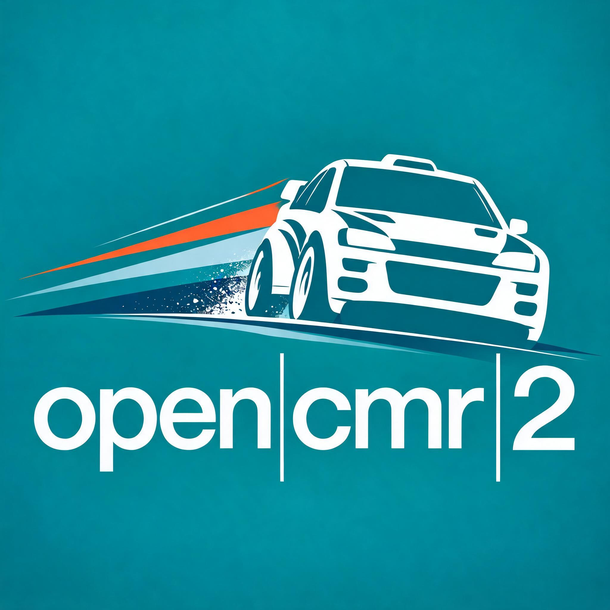
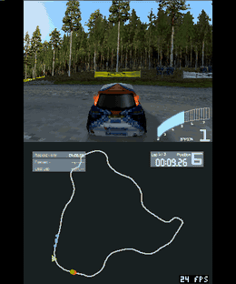
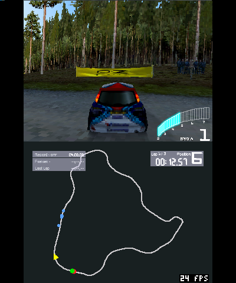
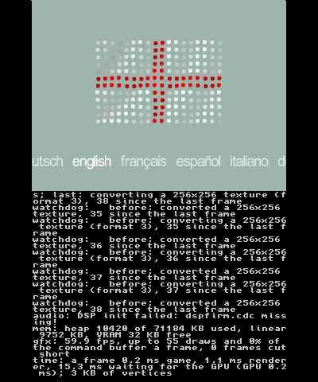

<p align="center">
  
</p>

# OpenCMR2

[](https://github.com/0zaRu/OpenCMR2-ds/actions/workflows/build.yml)

OpenCMR2 is a work-in-progress native port of **Colin McRae Rally 2.0** (PC, 2000)
to modern platforms, built on the [CMR2Decomp](https://github.com/pablocpas/CMR2Decomp)
decompilation. It runs the original game code natively on Linux, Windows,
macOS and Android, and experimentally on the Nintendo 3DS. There is no emulation and no Wine or DirectX wrapper: DirectDraw,
Direct3D 7, DirectSound, DirectInput, DirectPlay and Bink are replaced with
SDL3, the SDL GPU API (Vulkan, Metal) and the port's own code.

**OpenCMR2-ds** is the fork that brings the game to the **Nintendo 3DS**
family, as an installable CIA or a Homebrew Launcher application. The
step-by-step guide is in [Nintendo 3DS](#nintendo-3ds) below.

https://github.com/user-attachments/assets/3c7322dc-576b-4fb0-8d6a-4d17de6fe17d

*Colin McRae Rally 2.0 running on Linux with OpenCMR2.*

> [!WARNING]
> This repository contains no game assets. You need your own copy of the
> original PC version of Colin McRae Rally 2.0 to play.

## Status

Everything tested so far works: the intro videos, the menus, the stages and
network races over LAN. The project is still in development, so you may find
bugs. If you do, please [report them](https://github.com/pablocpas/OpenCMR2/issues).
The game code follows CMR2Decomp, and its progress is brought into the port
as it is made.

| Platform | Architecture | Status |
| --- | --- | --- |
| Linux | x86-64 | Plays stages and matches the original physics |
| Linux | i686 | Plays stages, reference build with the original memory layout |
| Linux | ARM64 | Builds and passes the tests, gameplay not yet tested |
| Windows | x86-64 | Plays stages and matches the original physics (tested under Wine) |
| macOS | ARM64 | Builds and passes the tests, gameplay not yet tested |
| Android | ARM64, x86-64 | Plays stages with on-screen controls (Android 10 or later, Vulkan) |
| Nintendo 3DS | ARM11 | Plays the menus and stages on an Old 3DS (CIA); being tuned ([3DS.md](docs/3DS.md)) |

### Features

* Native SDL3 platform layer for windowing, input, audio and files, with saves
  and settings in the user directory
* SDL GPU renderer (Vulkan, Metal) reproducing the Direct3D 7 fixed-function
  pipeline in shaders
* Fullscreen on the desktop resolution or a resizable window, switched with
  Alt+Enter
* Keyboard, mouse and gamepads through SDL3, and on-screen controls on Android
* Bink intro and country videos with a built-in decoder
* Multiplayer over LAN and the internet using UDP instead of DirectPlay
* Folder dialog on first launch to locate the game installation
* Fixes for some original bugs, such as German in the language menu loading
  Spanish

The improvements of [SilentPatch](https://cookieplmonster.github.io/mods/colin-mcrae-rally-2/)
are built in as well:

* Widescreen resolutions up to the desktop resolution, with the correct
  perspective instead of a stretched picture
* Configurable field of view
* High and variable frame rates without changing the game speed or the
  physics, verified against the original game

## Nintendo 3DS

<p align="center">
  
  
  
</p>

*Captured in the Azahar emulator (Old 3DS): a stage with the HUD shared by
both screens, and a menu drawn at full resolution.*

The whole game runs on the console: the same game code, built for its 32-bit
ARM11, with its own renderer on the PICA200 GPU. It works on the Old 3DS /
2DS and on the New 3DS / New 2DS XL (faster, with more memory).

### 1. What you need

* A 3DS with custom firmware, [Luma3DS](https://github.com/LumaTeam/Luma3DS)
  (see [3ds.hacks.guide](https://3ds.hacks.guide) if yours has none), and the
  title manager [FBI](https://github.com/lifehackerhansol/FBI) to install
  CIAs. The Homebrew Launcher is enough for the `.3dsx` instead.
* Your own copy of Colin McRae Rally 2.0 for the PC, **installed on a PC**:
  the 3DS reads the installed folders, not the CD.
* About 700 MB free on the SD card.
* For sound, the console's DSP firmware dump, `sd:/3ds/dspfirm.cdc`. If you
  do not have it, run [DSP1](https://github.com/zoogie/DSP1) once. Without it
  the game runs silently.

### 2. Get the CIA

Either download it or build it.

**Download it from this repository's CI.** Every push builds it:

1. Open [Actions → build](https://github.com/0zaRu/OpenCMR2-ds/actions/workflows/build.yml)
   and pick the latest run on `main` with a green tick (you need to be signed
   in to GitHub to download).
2. At the bottom of the run, under **Artifacts**, download `OpenCMR2-3DS`.
3. Unzip it, then unzip the `OpenCMR2-3DS.zip` inside: it holds
   `OpenCMR2.cia`, `opencmr2.3dsx`, `3DS.md` and the licence.

A tag `v...` pushed to the repository also publishes `OpenCMR2-3DS.zip` in
[Releases](https://github.com/0zaRu/OpenCMR2-ds/releases), which needs no
sign-in and does not expire like the CI's artifacts (90 days).

**Build it yourself** (Linux, macOS or WSL, with Docker), exactly as the CI
does: devkitARM, libctru and citro3d come with the `devkitpro/devkitarm`
image; makerom and bannertool, which pack the CIA, are built once:

```sh
git clone https://github.com/0zaRu/OpenCMR2-ds.git
cd OpenCMR2-ds
docker run --rm -v "$PWD:/src" -w /src devkitpro/devkitarm sh -c '
  fetch() { git init -q "$1" && git -C "$1" fetch -q --depth 1 "$2" "$3" && git -C "$1" checkout -q FETCH_HEAD; }
  fetch /tmp/ctr https://github.com/3DSGuy/Project_CTR d52c2b0e788c2d085763d7c5dcc4b2edd9ffb7d8
  make -C /tmp/ctr/makerom deps -j4 && make -C /tmp/ctr/makerom program -j4
  fetch /tmp/bt https://github.com/diasurgical/bannertool 16d8c5a0ce02a5e06e64ab42275132fca57c04a2
  git -C /tmp/bt submodule update --init --depth 1 && make -C /tmp/bt -j4
  mkdir -p /tmp/tools && cp /tmp/ctr/makerom/bin/makerom /tmp/bt/output/linux-x86_64/bannertool /tmp/tools/
  cmake --preset 3ds -DOPENCMR2_3DS_TOOLS=/tmp/tools && cmake --build --preset 3ds'
```

The results are `build/3ds/src/OpenCMR2.cia` and `build/3ds/src/opencmr2.3dsx`.
Without makerom and bannertool only the `.3dsx` is made. More on the build
in [3DS.md](docs/3DS.md#building).

### 3. Copy the game to the SD card

Put the SD card in a card reader (or use an FTP server on the console, such
as [ftpd](https://github.com/mtheall/ftpd)) and copy the **contents** of the
PC installation folder (by default
`C:\Program Files\Codemasters\Colin McRae Rally 2.0`: the folders `Game`,
`FrontEnd`, `Sounds`, ...) to `sd:/3ds/OpenCMR2/Data/`:

```
sd:/3ds/OpenCMR2/Data/Game/Bigfiles/common.bfl    <- this file must exist
sd:/3ds/OpenCMR2/Data/FrontEnd/...
sd:/3ds/OpenCMR2/Data/Sounds/...
```

The `Movies` folder can be left out: the videos are skipped on the 3DS. If
the files are in the wrong place, the game says so on the bottom screen
when it starts, with the path it looked in.

### 4. Install it

* **CIA (recommended: more memory and, on a New 3DS, the faster CPU):** copy
  `OpenCMR2.cia` anywhere on the SD card (for example `sd:/cias/`). On the
  console open FBI → **SD** → that folder → `OpenCMR2.cia` → **Install CIA**.
  OpenCMR2 then appears on the HOME Menu. A newer CIA installs over the old
  one, keeping saves and settings.
* **3dsx:** copy `opencmr2.3dsx` to `sd:/3ds/` and start it from the
  Homebrew Launcher.

### 5. Play

The top screen shows the game at 4:3; the bottom screen shows a log while it
loads. The buttons press the game's keyboard keys, so its controls menu
shows the keyboard:

| Button | Menus | Stage |
| --- | --- | --- |
| Circle Pad, D-Pad | Move | Steer (up and down also accelerate and brake) |
| A | Confirm | Accelerate |
| B | Back | Brake |
| Y | | Handbrake |
| R / L | | Gear up / down |
| X | System keyboard (typing) | Camera |
| START | Confirm | Pause |
| SELECT, touch screen | | Confirm |

The results after a stage, its replay and the pause menu are menus. While
driving, the top screen keeps only the rev counter and the gear; the bottom
screen shows a map of the stage with your car and the others, the stage and
split times, position, the co-driver's pace notes and the frame rate. In the
menus it shows the log.

**Network play** (new on the 3DS, being tested) works over wifi, with other 3DS consoles and with the PC
version on the same network: choose the game's network mode as on the PC.
To type a name or a chat message, press X in the menu for the system
keyboard. Details in [NETWORK.md](docs/NETWORK.md).

Settings, saves and the log are in `sd:/3ds/OpenCMR2/`. `opencmr2.ini` is
written with comments on the first launch; its `[3ds]` section sets the
texture size, the sharp menus, the map, the videos, stretching the picture
over the whole screen and the log on the bottom screen. For more speed on a
stage, lower the game's own draw distance and effects in its graphics
options. Every 600 frames the log notes the frame rate and where a frame's
time goes (`gfx:` and `time:` lines): send them with reports on speed.

### 6. If something goes wrong

* "Game data not found": the folders are not in `sd:/3ds/OpenCMR2/Data/`
  (step 3).
* No sound: `sd:/3ds/dspfirm.cdc` is missing (step 1).
* The game stops or returns to the HOME Menu: please
  [open an issue](https://github.com/0zaRu/OpenCMR2-ds/issues) with
  `sd:/3ds/OpenCMR2/opencmr2.log` and what you were doing. With Luma3DS, a
  crash dump from `sd:/luma/dumps/arm11/` helps too.

What is left out on the 3DS (car reflections, videos by default) and how
the port is put together is in [3DS.md](docs/3DS.md).

## Approach

The game code in `game/` comes from CMR2Decomp and is kept as close to the
original as possible. Every change the port needs is marked with a `PORT:`
comment. The rest of the port (`src/`) implements the platform APIs the game
expects on top of SDL3.

Accuracy is tested against the original executable rather than assumed:

* The fixed-point helpers are compared with the original x87 assembly
* The startup math tables (16,896 entries) are compared with dumps from the
  original game
* 500 vehicle updates of a Finland stage, driven by recorded input, are
  compared field by field with the original game + SilentPatch at 30, 60,
  120, 144 and 240 FPS and at a variable frame rate. All of them match bit
  for bit ([details](docs/PHYSICS_PARITY.md)).

Graphical enhancements will be added one at a time and kept optional, so the
original look stays available.

## Running

Download the package for your platform from
[Releases](https://github.com/pablocpas/OpenCMR2/releases):

| Platform | Package |
| --- | --- |
| Windows x64 | `OpenCMR2-Windows-x64.zip` |
| Linux x86-64 | `OpenCMR2-Linux-x86_64.tar.gz` |
| Linux ARM64 | `OpenCMR2-Linux-arm64.tar.gz` |
| Linux 32-bit | `OpenCMR2-Linux-i686.tar.gz` |
| macOS (Apple silicon) | `OpenCMR2-macOS-arm64.zip` |
| Android | `OpenCMR2-Android.apk` |
| Nintendo 3DS | `OpenCMR2-3DS.zip` (`.cia` and `.3dsx`): see [Nintendo 3DS](#nintendo-3ds) |

Extract it and run `opencmr2`. On first launch, choose the folder of your PC
installation. The installation itself, a folder inside it or a parent folder
all work. The location is checked and remembered, and the game files stay
where they are.

If you have the CD or an ISO, install the game or extract it first: OpenCMR2
reads the installed folders (`Game`, `FrontEnd`, `Sounds`, ...).

On Android, install the APK and copy the installation folder to the
device first. On first launch, choose it in the system's folder picker: the
game files are copied into the app once (about 700 MB), as Android gives
apps no direct access to other folders. The on-screen controls press the
default keyboard keys, so they work in the menus and on the stages, and
hide while a gamepad is used, external or built into a handheld. Back pauses the game.

The Linux packages are built on Ubuntu 24.04 and need a distribution of
similar age or newer. The macOS package is not signed: after extracting it,
run `xattr -dr com.apple.quarantine OpenCMR2-macOS-arm64` once.

Command-line options:

| Option | Description |
| --- | --- |
| `--data <dir>` | Use this game installation and skip the folder dialog |
| `--user-dir <dir>` | Keep saves, settings and logs in this directory |

The installation can also be set with the `OPENCMR2_DATA` environment variable
or `[paths] data` in `opencmr2.ini`, or copied into a `Data` folder next to the
executable, which is found without asking.

## Configuration

Settings are stored in `opencmr2.ini` in the user directory
(`~/.local/share/OpenCMR2/` on Linux,
`%APPDATA%\OpenCMR2\` on Windows; files from the older
`OpenCMR2/OpenCMR2` folder are moved there).
It is created with comments on first launch.

| Setting | Default | Description |
| --- | --- | --- |
| `[video] fullscreen` | `1` | Fullscreen (`1`) or window (`0`), changed and saved by Alt+Enter |
| `[video] fov` | `70` | Field of view in degrees, 30 to 150 (70 is the original) |
| `[video] run_in_background` | `0` | Keep running when the window loses focus |
| `[install] language` | `English` | English, American, French, German, Italian, Spanish or Polish |
| `[install] sku` | `EUROPE` | Game edition: `EUROPE`, `AMERICA`, `POLAND` or `JAPAN` |
| `[install] menu_shortcut` | asked | Entry in the applications menu (Linux) or Start menu (Windows): `1` keeps it pointing at this copy, `0` removes it |
| `[net] ...` | | Network play, see [NETWORK.md](docs/NETWORK.md) |

## Building

OpenCMR2 builds with Clang, CMake 3.24+, Ninja and glslang, using the presets
in `CMakePresets.json`:

| Preset | Target |
| --- | --- |
| `linux` | Linux, 64-bit (x86-64 or ARM64) |
| `windows-x64` | Windows x64 (`clang++` with the MSVC runtime) |
| `macos` | macOS, Apple silicon |
| `linux-x86` | Linux, 32-bit x86 (reference build for the tests) |
| `3ds` | Nintendo 3DS, with devkitARM (see [3DS.md](docs/3DS.md#building)) |

OpenCMR2 needs SDL 3.4 or later. An installed SDL3 of that version is used;
otherwise CMake downloads and builds it and places it next to the executable
(to force this, pass `-DOPENCMR2_VENDORED_SDL=ON`). Start by cloning the repository:

```sh
git clone https://github.com/0zaRu/OpenCMR2-ds.git
cd OpenCMR2-ds
```

### Linux

Install the dependencies.

Fedora (SDL3-devel is used when it is 3.4 or later):

```sh
sudo dnf install clang cmake ninja-build glslang SDL3-devel
```

Ubuntu 24.04 or Debian, where SDL3 is built from source with these
development libraries:

```sh
sudo apt install clang cmake ninja-build glslang-tools pkg-config \
    libx11-dev libxext-dev libxrandr-dev libxcursor-dev libxi-dev libxss-dev libxtst-dev \
    libxkbcommon-dev libwayland-dev wayland-protocols libegl1-mesa-dev \
    libasound2-dev libpulse-dev libudev-dev libdbus-1-dev
```

Then build:

```sh
cmake --preset linux
cmake --build --preset linux
```

The executable is `build/linux/src/opencmr2`.

### macOS

```sh
brew install cmake ninja glslang sdl3
cmake --preset macos
cmake --build --preset macos
```

Metal needs MSL shaders, so the build fetches SPIRV-Cross to translate them
(or uses `spirv-cross` from the `PATH`).

### Windows

Install Visual Studio 2022 with its "C++ Clang tools" component (or LLVM),
Ninja and [glslang](https://github.com/KhronosGroup/glslang/releases). From an
"x64 Native Tools" command prompt:

```bat
cmake --preset windows-x64
cmake --build --preset windows-x64
```

`clang-cl` is not supported, as the build uses GNU-style options. To
cross-build from Linux with LLVM-MinGW, see [WINDOWS.md](docs/WINDOWS.md).

### Android

The Gradle project in `android/` builds the same CMake project with the
Android NDK. It needs JDK 17 or later, the Android SDK (with `ANDROID_HOME`
set or `sdk.dir` in `android/local.properties`) and glslang on the `PATH`.
Gradle downloads SDL's source and fetches the NDK, CMake and SDK platform
when the SDK licences are accepted:

```sh
cd android
./gradlew assembleRelease
```

The APK is `android/app/build/outputs/apk/release/app-release.apk`. It is
signed with the release key given by `OPENCMR2_KEYSTORE`,
`OPENCMR2_KEYSTORE_PASSWORD`, `OPENCMR2_KEY_ALIAS` and
`OPENCMR2_KEY_PASSWORD` (or the `opencmr2.keystore` Gradle properties), and
with the debug key otherwise.

### Tests

```sh
ctest --preset linux
```

The 32-bit `linux-x86` build keeps the original data layout and is the
reference for the tests against the original game. Its dependencies and
the rest of the development workflow are described in
[DEVELOPMENT.md](docs/DEVELOPMENT.md).

## Documentation

| Document | Contents |
| --- | --- |
| [ARCHITECTURE.md](docs/ARCHITECTURE.md) | Source layout, platform APIs and renderer design |
| [DEVELOPMENT.md](docs/DEVELOPMENT.md) | Tests, syncing with CMR2Decomp, repository conventions |
| [PHYSICS_PARITY.md](docs/PHYSICS_PARITY.md) | Physics and timing comparison with the original game |
| [ORIGINAL_REFERENCE.md](docs/ORIGINAL_REFERENCE.md) | Recording the original game for the comparisons |
| [BASELINE.md](docs/BASELINE.md) | Stage capture, replay and CPU profiling |
| [NETWORK.md](docs/NETWORK.md) | Network play setup and protocol |
| [VIDEO.md](docs/VIDEO.md) | Bink decoder |
| [WINDOWS.md](docs/WINDOWS.md) | Release packages and cross-building for Windows |
| [3DS.md](docs/3DS.md) | Nintendo 3DS: installing, controls, limits and building |
| [64bit-raw-access.md](docs/64bit-raw-access.md) | 64-bit memory access audit |

The full index is in [docs/README.md](docs/README.md).

## Credits

* [CMR2Decomp](https://github.com/pablocpas/CMR2Decomp), the decompilation
  this port is built on
* Silent, for [SilentPatch](https://cookieplmonster.github.io/mods/colin-mcrae-rally-2/),
  whose improvements are built in and which is the reference for the
  comparisons with the original game
* The [SDL](https://libsdl.org) and [ENet](http://enet.bespin.org) projects
* Filippo Scognamiglio for [RadialGamePad](https://github.com/Swordfish90/RadialGamePad),
  the on-screen controls on Android
* Konstantin Shishkov, Peter Ross and Daniel Verkamp for FFmpeg's Bink
  decoder, which `src/video/` is adapted from

## Licence

OpenCMR2 is licensed under the [GPL-3.0](LICENSE). Bundled third-party code
keeps its own licence: SDL3 (zlib), ENet (MIT), the Bink decoder (LGPL-2.1)
and RadialGamePad (GPL-3.0). The Nintendo 3DS build also links libctru and
citro3d (zlib).

OpenCMR2 is an unofficial project, not affiliated with or endorsed by
Codemasters or Electronic Arts. Colin McRae Rally 2.0 is a trademark of its
respective owners.
